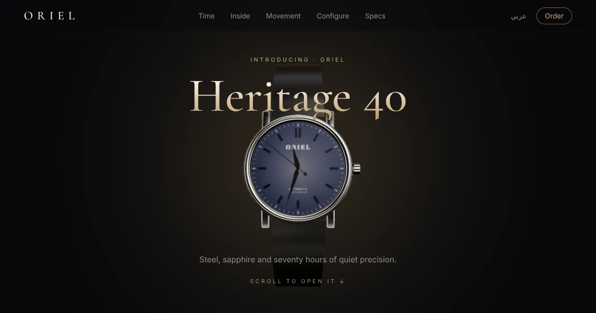

# ORIEL Heritage 40 — 3D Luxury Watch

A launch page for a luxury automatic watch, built around a real-time 3D model made entirely in code.

**Live:** [oriel-watch-gamma.vercel.app](https://oriel-watch-gamma.vercel.app) · Part of my [portfolio](https://aya-khamaysa-portfolio.vercel.app)



## Highlights

- **Live time:** the hands show the visitor's real time, with a smooth sweeping seconds hand.
- **Exploded view:** scroll and the watch opens layer by layer (crystal, bezel, hands, dial, movement, caseback).
- **Living movement:** turn it over to see the gears turn, the balance wheel swing and the rotor spin.
- **Configurator:** case metal, dial and strap, each with its own price.
- **Presentation box:** the watch rests in its branded box, strap wrapped around the cushion, ready to order on WhatsApp.
- **No 3D files:** every part and finish (sunburst dial, perlage, Côtes de Genève, leather grain) is generated in code.
- Drag to turn, English / Arabic (RTL).

## Built with

React · Three.js · React Three Fiber · drei · Framer Motion · Tailwind CSS · Vite

## Run locally

```bash
npm install
npm run dev
```

## Edit
- Choices, prices, specs, WhatsApp number: `src/data/watch.js`
- Texts (English / Arabic): `src/data/ui.js`
- The watch parts: `src/components/Watch.jsx`
- Where the watch stands in each section: `src/components/Stage.jsx` (`POSES`)

> ORIEL is a fictional brand for a portfolio concept.

---

Designed & built by **Aya Khamaysa** · [Portfolio](https://aya-khamaysa-portfolio.vercel.app) · [LinkedIn](https://www.linkedin.com/in/ayakhamaysa) · [One Click](https://www.instagram.com/oneclick.ps)
